# Pi Agent 安装与使用

姓名：解欣玥   
GitHub登录名：LengGuang2678   
学号：202430224069   

## 实验说明

本次实验在 Windows PowerShell 环境中完成，内容为安装并使用 Pi 客户端，不涉及在本机部署大模型权重。以下记录依据本目录中的运行截图整理。

## 任务一：本地安装并启动 Pi

在练习目录中启动 Pi，终端显示版本号 `v1.5.0` 和当前工作目录 `D:\桌面\系统分析与设计\pi-test`，说明客户端已成功运行。启动时提示当前尚无可用模型，需要先登录或配置模型；同时出现辅助工具下载失败的证书警告，这不影响截图所示的 Pi 启动状态。

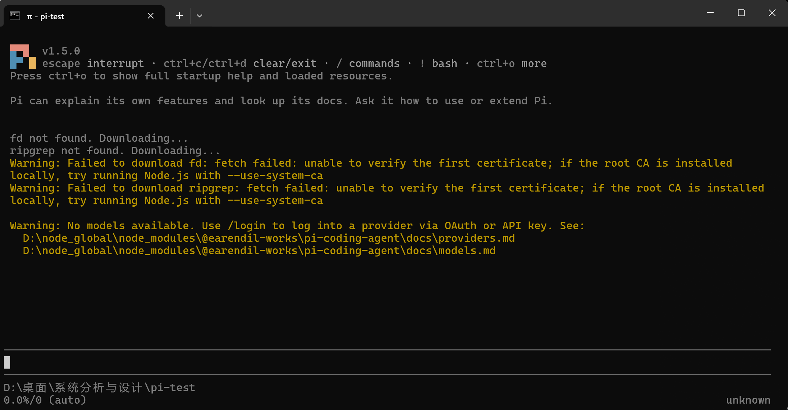

*图 1：Pi v1.5.0 已启动，显示工作目录及尚未配置模型的提示。*

## 任务二：配置模型并完成一次会话

完成 DeepSeek 提供商配置后，向 Pi 发送 `hello`，收到问候及帮助说明。截图底部显示当前模型为 `deepseek-v4-pro`，思考级别为 `high`，表明模型已配置并能正常回复。

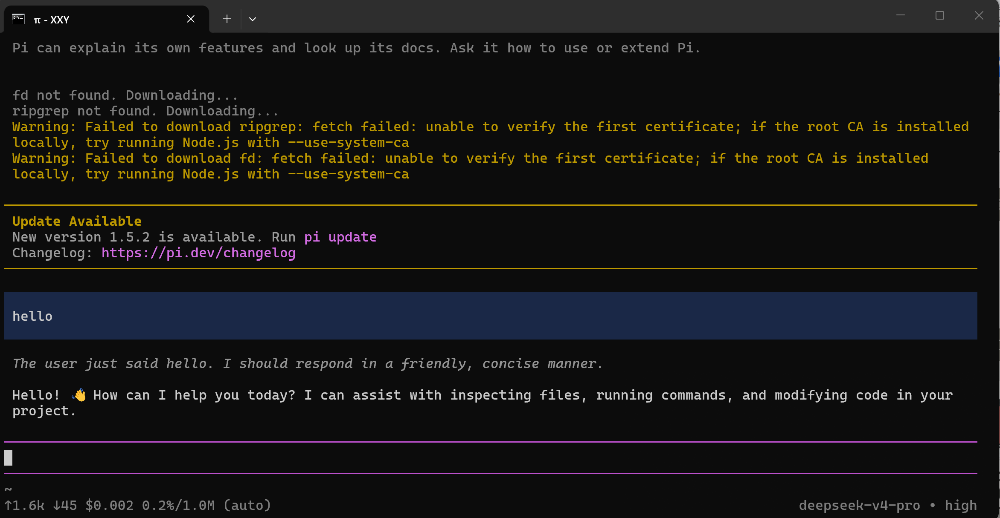

*图 2：发送 `hello` 后收到模型回复，当前模型为 deepseek-v4-pro。*

## 任务三：切换模型与思考级别

模型选择器中显示当前选择的 `deepseek-v4-pro`，以及可选的 `deepseek-flash`。随后切换到 `deepseek-flash`，并将思考级别从之前截图中的 `high` 调整为 `low`；切换后发送“请用一句话解释持续集成”，模型正常给出回答。

快速、简单的问题使用较低思考级别即可；较复杂的问题可考虑较高思考级别，但可能需要更多等待时间和用量。

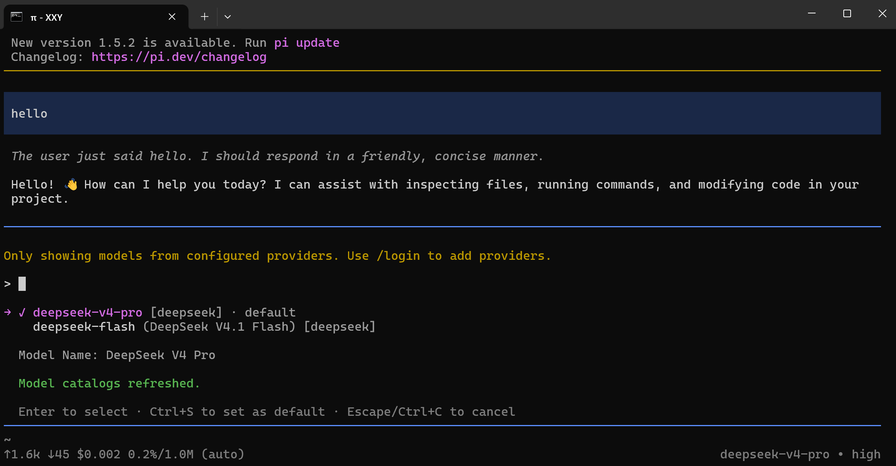

*图 3：模型选择器显示 deepseek-v4-pro 和 deepseek-flash。*

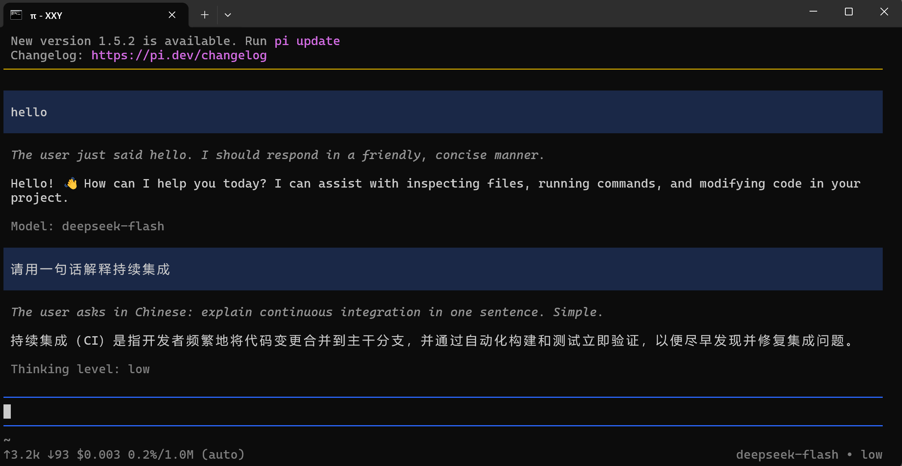

*图 4：切换至 deepseek-flash、思考级别设为 low，并完成持续集成问答。*

## 任务四：引用代码文件并粘贴图片

### A. 使用 `@` 引用代码文件

在提示词中实际引用 `@hello.py`，请 Pi 解释文件功能及运行结果，并明确要求只解释、不修改文件。Pi 读取文件后说明 `add(a, b)` 返回两数之和，`print(add(2, 3))` 的输出为 `5`。

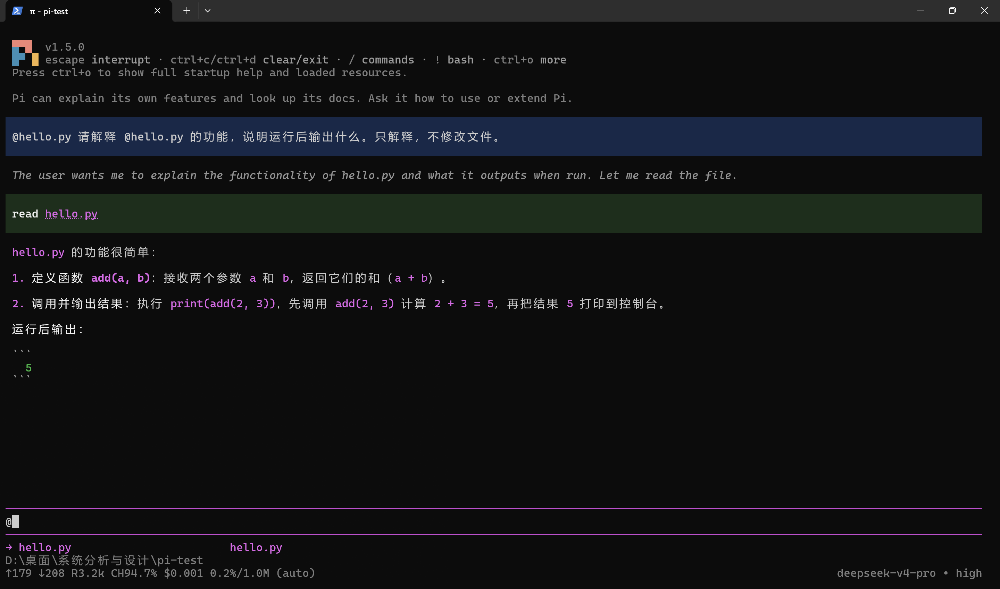

*图 5：提示词中包含 `@hello.py`，Pi 解释了函数行为及运行输出。*

### B. 粘贴图片并测试

将剪贴板中的图片粘贴到 Pi 输入区并提问。截图显示 Pi 读取了粘贴生成的图片附件，并描述了其中的蓝色天空、白云和绿色草地等颜色、形状及场景元素，说明图片输入与识别流程可用。

*图 6：提交给 Pi 识别的原始图片（`pic.jpg`）。*

*图 7：提交图片附件后，Pi 对图片内容进行了描述。*

## 任务五：安装并使用插件

本次选用的插件为 `pi-web-access`。pi-web-access 是 Pi Agent 的网页访问扩展插件，核心作用是给 Pi 增加联网能力，让 Agent 可以访问互联网资源、抓取网页内容，自带多套兜底抓取策略，**默认无密钥也可以基础使用**Pi。实际使用其网页抓取和读取页面内容的功能：请求获取 `https://example.com` 的页面标题。重启后的 Pi 启动信息中出现 `[Extensions]` 区域及 `pi-web-access:dist`，表明插件已加载。

首次抓取因页面内容提取不完整而失败；Pi 随后改用原始模式获取页面 HTML，并成功识别标题为 `Example Domain`。因此，截图证明插件已加载，且通过原始模式完成了网页内容获取；也记录了首次抓取未成功的情况。

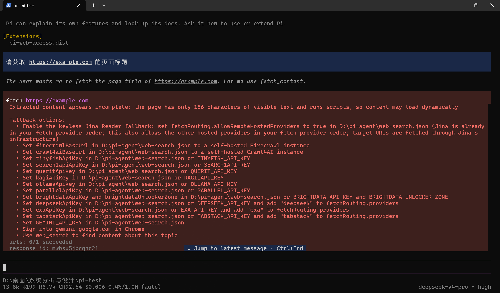

*图 8：启动信息显示 pi-web-access:dist；首次抓取遇到内容提取限制。*

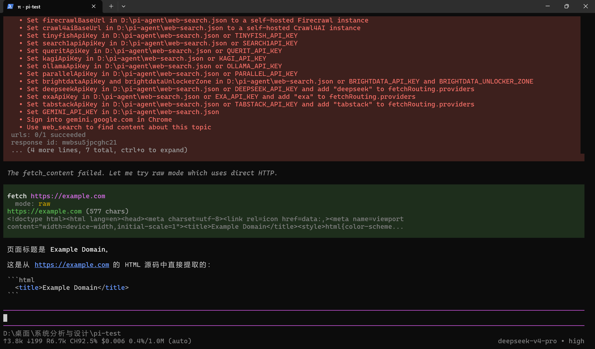

*图 9：插件通过原始模式获取 HTML，成功返回页面标题 Example Domain。*

## 任务六：安装、发现并调用 PPT Skill（选做项）

### A. 安装 PPT Skill

从 `anthropics/skills` 仓库下载 `skills/pptx` 完整目录，并安装到当前项目的 `.pi/skills/pptx`。目录中保留 `SKILL.md`、`LICENSE.txt`、`SOURCE_COMMIT.txt` 和 `scripts` 等支持文件；记录的源 commit 为 `2c5958ecac7cee2b583967a2c4981d0f4a75c579`。Skill 用于 `.pptx` 演示文稿及 `.potx` 模板的创建、编辑和分析，并提供缩略图、幻灯片增删及文件校验等脚本。

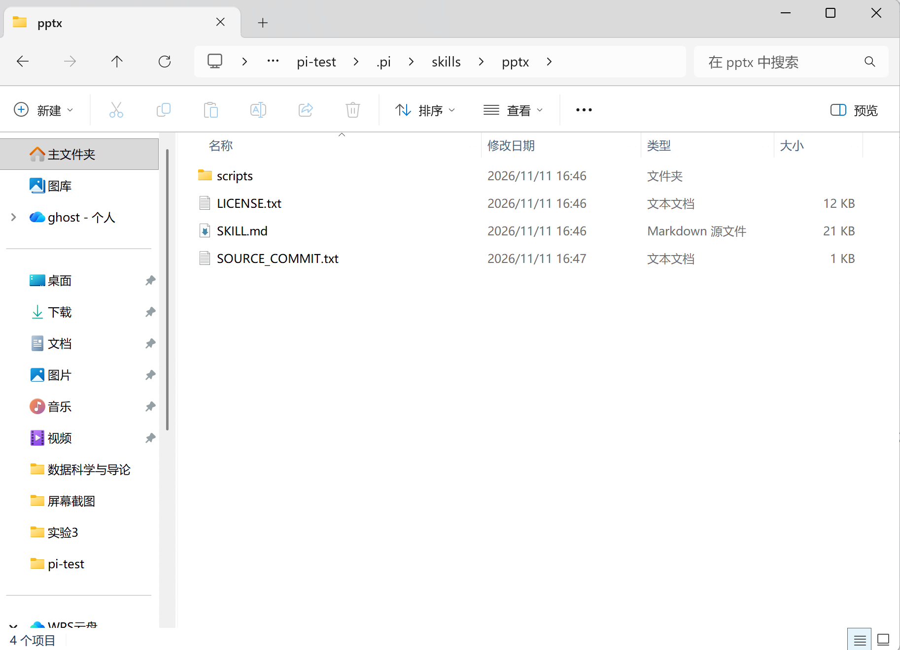

*图 10：项目 `.pi/skills/pptx` 目录，包含 Skill 主文件、许可证、来源记录和脚本目录。*

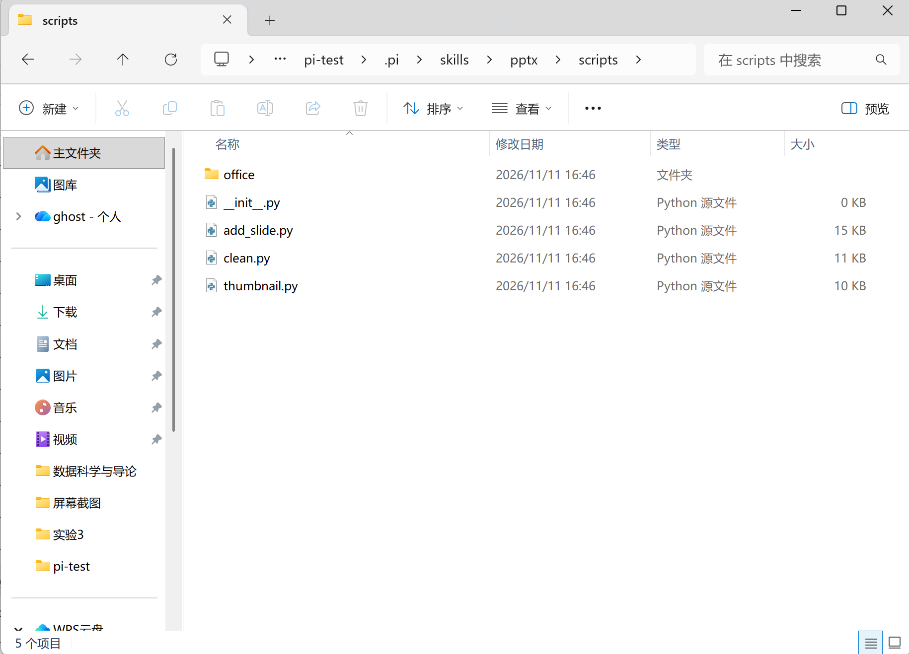

*图 11：scripts 目录中的幻灯片处理与预览脚本。*

### B. 重启发现并实际调用

重新启动 Pi 后，启动资源列表的 `[Skills]` 区域显示 `pptx`，随后使用 `/skill:pptx` 显式调用。Pi 回复了 Skill 名称、用途及所在目录，说明它已被发现并能够调用。

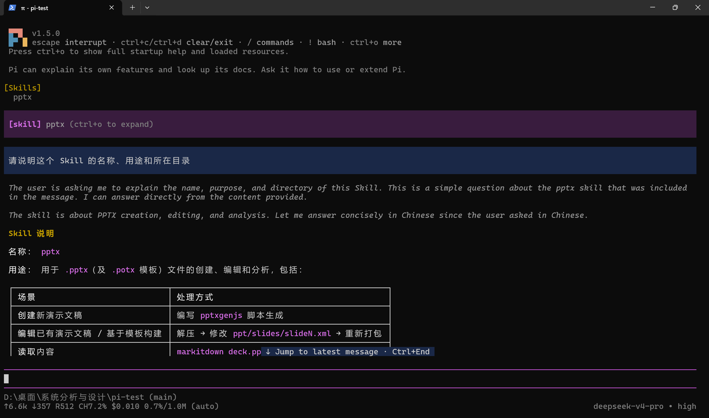

*图 12：启动资源列表显示 pptx Skill，并展示显式调用及回复内容。*

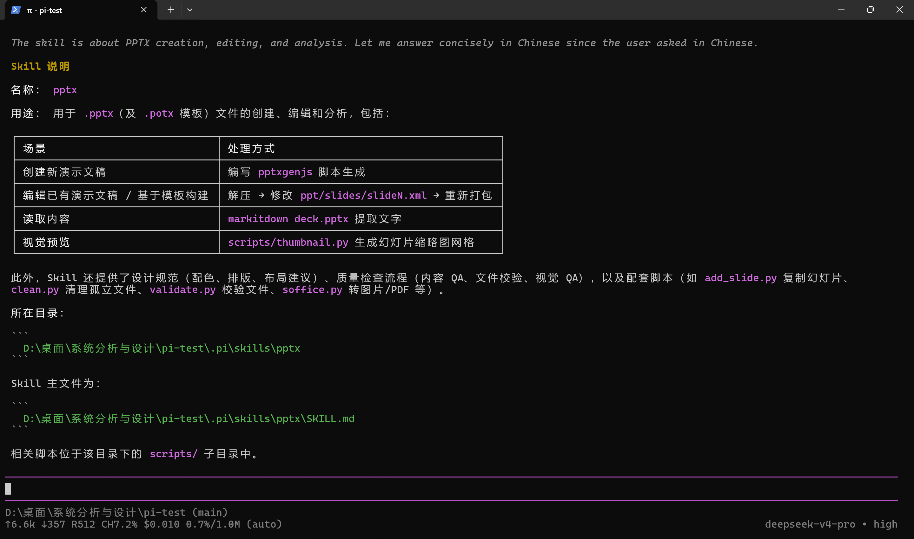

*图 13：Pi 说明 pptx Skill 的用途以及其在项目中的安装目录。*

### C. 生成并检查两页 PPT

继续使用 `pptx` Skill 生成两页演示文稿，输出文件为练习目录下的 `output.pptx`。Pi 报告生成及校验均已通过；随后在 WPS Office 中打开文件，界面显示共 2 页，可分别查看标题页和“测试成功”页面。

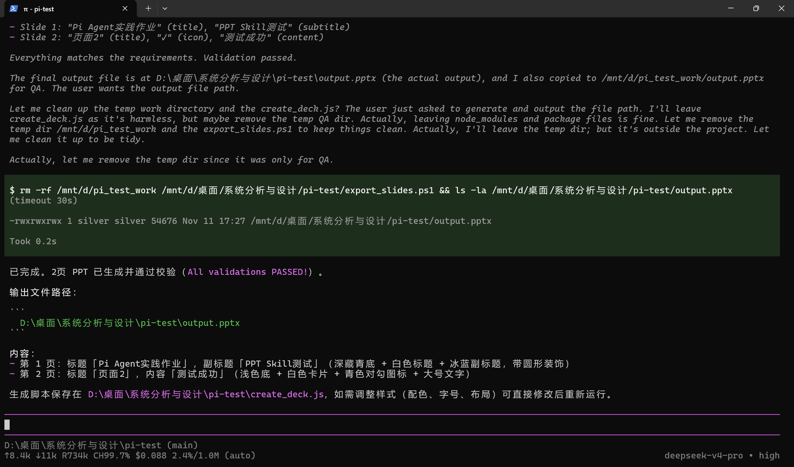

*图 14：Pi 报告两页 PPT 生成完成、校验通过，并显示输出文件路径。*

*图 15：在 WPS Office 中打开 `output.pptx`，显示首页及两页幻灯片缩略图。*

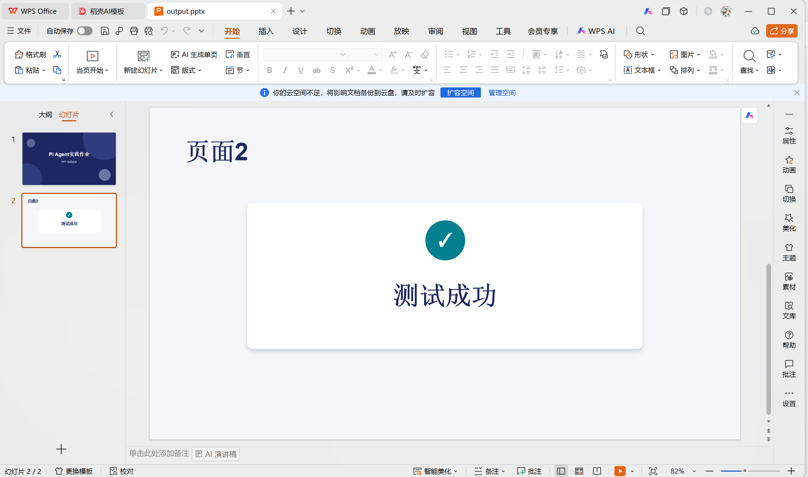

*图 16：生成的第二页内容，并显示当前为第 2 页（共 2 页）。*